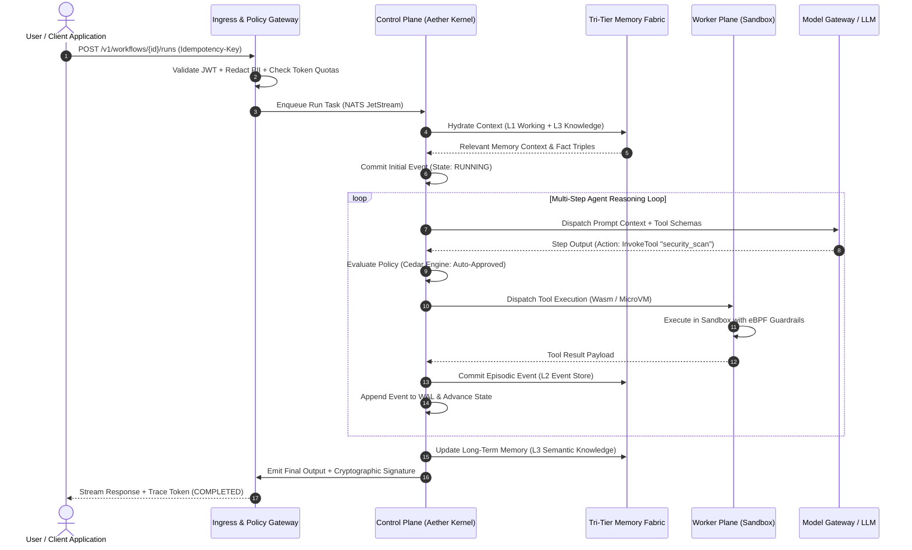
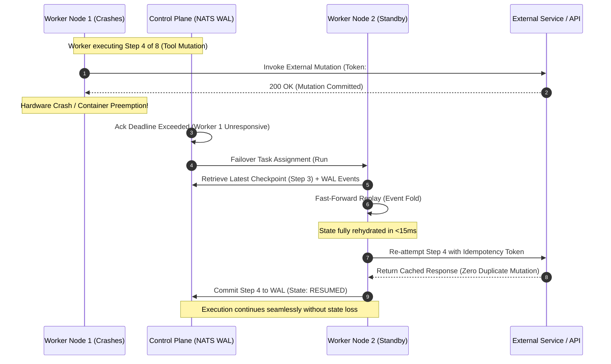
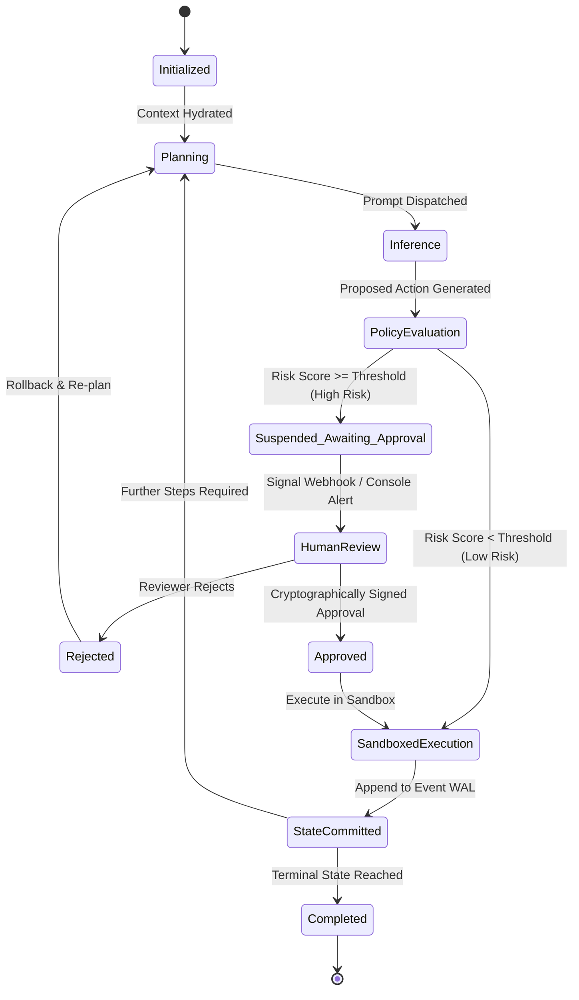

# AETHER Technical Architecture & System Blueprint

**The Distributed Sovereign Agent Operating System & Deterministic Execution Fabric**  
**Document Class:** Master System Architecture Specification  
**Version:** 1.0.0  
**Status:** Canonical Engineering Blueprint

---

## 1. Executive Summary & Core Philosophy

Autonomous multi-agent systems represent a paradigm shift in software engineering. However, prevailing agent frameworks treat multi-agent execution as a scripting problem rather than a distributed systems problem. They suffer from catastrophic amnesia upon process restarts, non-deterministic state crashes, uncontained cloud expenses, and severe security vulnerabilities resulting from arbitrary tool execution on host environments.

**AETHER** resolves these foundational failures by providing a compiled, high-throughput, event-sourced distributed runtime. Built on a memory-safe **Rust** kernel (`aetherd`), **PostgreSQL 16 with pgvector**, **NATS JetStream** Raft write-ahead logging, and dual-tier sandboxing (**Wasmtime & Firecracker**), Aether delivers mathematical determinism, microsecond-latency task dispatch, and zero-trust sovereign isolation.

---

## 2. Target Audience & Stakeholder Personas

AETHER is architected to address the enterprise requirements of three distinct stakeholder classes operating at the intersection of foundation models and mission-critical distributed systems:

```
+---------------------------------------------------------------------------------------+
|                                AETHER TARGET PERSONAS                                 |
+---------------------------------------------------------------------------------------+
|  Enterprise Platform Engineers  |  Autonomous AI App Developers  |  SecOps & SRE Architects  |
|  - Fortune 500 banks/health     |  - Complex multi-agent teams   |  - Zero-trust compliance  |
|  - Air-gapped/on-prem clouds    |  - High-concurrency workflows  |  - Cost/token containment |
|  - Sovereign AI governance      |  - Deterministic bug replay    |  - Auditability & SLA     |
+---------------------------------------------------------------------------------------+
```

### 2.1 Persona 1: Enterprise Platform & Infrastructure Engineers

- **Profile & Environment:** Platform engineering teams in highly regulated sectors (financial services, healthcare, defense, telecommunications) deploying across sovereign clouds, on-prem air-gapped Kubernetes clusters, and private VPC enclaves.
- **Primary Operational Needs:**
  - An infrastructure-grade runtime capable of operating in air-gapped environments without mandatory public cloud egress.
  - Hard compliance alignment with SOC 2 Type II, HIPAA, and GDPR standards.
  - Zero-trust identity integration with SPIFFE/SPIRE x509 SVIDs and OIDC/JWT federation.
  - Cryptographically signed audit logs (ed25519) providing mathematical non-repudiation for regulatory examiners.
  - Strict multi-tenant data isolation preventing cross-tenant model prompt or memory leakage.
- **Pain with Existing Solutions:** Prevailing agent frameworks are unstructured Python scripting libraries lacking native multi-tenancy, enterprise RBAC/ABAC guardrails, connection pooling, and secure secrets management. They default to executing uncontained code on the host operating system.
- **AETHER Value Proposition:** Compiled Rust core daemon (`aetherd`) with embedded Raft consensus, declarative Cedar authorization policies, and hardware-isolated Firecracker microVMs.

### 2.2 Persona 2: Autonomous AI Application Developers & AI Engineers

- **Profile & Environment:** Product engineering teams and AI startups constructing multi-agent, multi-step autonomous workflows (e.g., automated code synthesis, financial intelligence analysis, continuous vulnerability remediation).
- **Primary Operational Needs:**
  - Resilient, durable execution semantics where a 25-step agent saga does not fail at step 24 due to upstream LLM rate-limiting, transient network disconnects, or container eviction.
  - Deterministic time-travel replay enabling developers to reproduce and debug rare hallucinations or tool errors by stepping through historical event sequences.
  - Strongly typed, idiomatic polyglot SDKs (TypeScript & Python) with automatic schema generation, structured outputs, and streaming execution events.
  - Built-in human-in-the-loop (HITL) approval primitives for high-consequence agent actions (e.g., executing financial transfers or modifying production infrastructure).
- **Pain with Existing Solutions:** LangChain, AutoGen, and CrewAI suffer from memory leaks, recursive hallucination loops, non-deterministic state crashes, and brittle JSON schema parsing that terminates entire execution pipelines without rollback mechanisms.
- **AETHER Value Proposition:** Event-sourced saga orchestration ($S_t = \text{fold}(S_0, [E_1 \dots E_t])$) with automatic checkpointing, idempotency keys, and sub-millisecond Wasm sandbox invocation.

### 2.3 Persona 3: SREs, SecOps & AI Safety Officers

- **Profile & Environment:** Site reliability engineering and security operations teams responsible for running multi-agent swarms at scale while managing seven-figure cloud API budgets.
- **Primary Operational Needs:**
  - Granular cost and token accounting with hard, real-time circuit breakers and tenant-level budget caps.
  - Real-time prompt-injection defense and zero-copy PII redaction (SSNs, API tokens, medical identifiers) before prompts are persisted to disk or sent to model providers.
  - Sandboxed tool isolation enforcing strict CPU fuel rationing, memory ceilings, and eBPF network egress whitelists.
  - Native OpenTelemetry distributed tracing and Prometheus metrics tracking token consumption, latency percentiles (p95/p99), and step failure rates.
- **Pain with Existing Solutions:** Unbounded recursive agent spawning that exhausts API quotas overnight, zero visibility into agent decision pathways, and severe vulnerability to prompt injection attacks executing destructive shell commands (`rm -rf`) inside container environments.
- **AETHER Value Proposition:** Multi-dimensional Redis Lua token buckets, Cilium eBPF network jails, automated upstream provider failover cascades, and Merkle-linked audit logging.

---

## 3. Four-Plane System Topology

Aether is architected into four decoupled planes designed for horizontal elasticity, zero-trust boundaries, and high-availability operations:

```
+===================================================================================================+
|                                    AETHER GLOBAL SYSTEM TOPOLOGY                                  |
+===================================================================================================+
|                                                                                                   |
|  [ INGRESS & POLICY GATEWAY ]                                                                     |
|  +--------------------+  +---------------------+  +--------------------+  +--------------------+  |
|  | REST / OpenAPI 3.1 |  | gRPC (HTTP/2 mTLS)  |  | WebSocket Streams  |  | OIDC / SPIFFE Auth |  |
|  +--------------------+  +---------------------+  +--------------------+  +--------------------+  |
|  +--------------------+  +---------------------+  +--------------------+  +--------------------+  |
|  | PII & Prompt Shield|  | Token Bucket Limiter|  | Circuit Breakers   |  | Cryptographic Sign |  |
|  +--------------------+  +---------------------+  +--------------------+  +--------------------+  |
|                                         |                                                         |
|                                         v                                                         |
|  [ CONTROL PLANE: THE AETHER KERNEL (Rust / Tokio) ]                                              |
|  +---------------------------------------------------------------------------------------------+  |
|  | Distributed State Machine Engine (Event-Sourced Saga Orchestrator)                          |  |
|  | - Append-Only Event Journal          - Speculative Execution Branching                      |  |
|  | - Raft Consensus Cluster             - Checkpoint & Rehydration Scheduler                   |  |
|  +---------------------------------------------------------------------------------------------+  |
|  | Agent Swarm Coordinator & Scheduler                                                         |  |
|  | - Task Priority Queue (Priority Heap) - Worker Affinity & GPU-Aware Routing                |  |
|  | - Human-in-the-Loop (HITL) Signal Bus - Dead-Letter & Rollback Manager                      |  |
|  +---------------------------------------------------------------------------------------------+  |
|                                         |                                                         |
|                     +-------------------+-------------------+                                     |
|                     |                                       |                                     |
|                     v                                       v                                     |
|  [ TRI-TIER MEMORY FABRIC ]               [ WORKER PLANE (Execution Sandboxes) ]                  |
|  +-------------------------------------+  +----------------------------------------------------+  |
|  | TIER 1: Ephemeral Working Memory    |  | Micro-Worker Daemons (Rust / Go / Python / TS)     |  |
|  | - Sliding Window Context Scratchpad |  | - Task Pull / gRPC Stream Workers                  |  |
|  | - In-Memory KV-Cache & Prompt Cache |  +----------------------------------------------------+  |
|  +-------------------------------------+  | Isolation Runtime Engines                          |  |
|  | TIER 2: Episodic Event Graph        |  | - MicroVM Sandboxes (Firecracker - Untrusted Code) |  |
|  | - Immutable Execution Log (Postgres)|  | - WebAssembly Sandboxes (Wasmtime - Fast Tools)    |  |
|  | - Temporal State Transitions        |  | - eBPF Network & Filesystem Jail                   |  |
|  +-------------------------------------+  +----------------------------------------------------+  |
|  | TIER 3: Semantic Knowledge Graph    |  | Model Gateway & Semantic Cache Mesh                |  |
|  | - Vector Embeddings (HNSW / Qdrant) |  | - Multi-LLM Provider Mesh (vLLM, TensorRT, OpenAI) |  |
|  | - Relational Entity/Relation Triples|  | - Semantic Exact/Fuzzy Prompt Response Caching     |  |
|  +-------------------------------------+  +----------------------------------------------------+  |
|                                                                                                   |
|  [ OBSERVABILITY & TIME-TRAVEL DEBUGGER ]                                                         |
|  +--------------------+  +---------------------+  +--------------------+  +--------------------+  |
|  | OpenTelemetry GenAI|  | Time-Travel Replay  |  | Immutable Audit    |  | Real-Time Console  |  |
|  | Distributed Tracing|  | Step Debugger Engine|  | Ledger (ed25519)   |  | Web UI & Metrics   |  |
|  +--------------------+  +---------------------+  +--------------------+  +--------------------+  |
+===================================================================================================+
```

---

### 3.1 Plane 1: Ingress & Policy Gateway

- **Zero-Trust Identity**: Terminates public TLS 1.3, authenticates user JWTs via OIDC providers, and verifies worker microVM identities via SPIFFE/SPIRE x509 SVIDs.
- **PII & Prompt Shielding**: Zero-copy regex and Rust string inspection scrubs API keys, SSNs, and credit cards before persisting prompts. An adversarial classifier blocks direct prompt-injection vectors.
- **Distributed Multi-Dimensional Rate Limiting**: Evaluated in Redis/Dragonfly using atomic Lua token-bucket algorithms across requests-per-minute (RPM) and tokens-per-minute (TPM).
- **Asymmetric Action Signing**: Outgoing state mutations (e.g. database transactions, external API writes) are signed via `ed25519` private keys, creating non-repudiable audit trails.

---

### 3.2 Plane 2: Control Plane Rust Kernel (`aetherd`)

- **Event-Sourced Saga Orchestrator**: Manages execution state as an append-only event stream. Eliminates destructive in-place state updates.
- **Distributed Raft Consensus (`aether-raft`)**: High-availability multi-node cluster leader election and linearizable state log replication across engine instances.
- **Task & Swarm Scheduler**: Work-stealing priority scheduler that matches tasks to worker nodes based on capability tags, GPU availability, and network locality.
- **Dual-Control HITL Interceptor**: Automatically suspends execution when a proposed action exceeds organizational risk thresholds, requiring signed cryptographic approvals before advancing.

---

### 3.3 Plane 3: Worker Plane (Zero-Trust Sandboxes)

- **Tier A: WebAssembly (`Wasmtime`) Sandboxing**: Microsecond instantiation (<5ms) for deterministic, stateless data transformations, math execution, and JSON parsing. Provides hardware-enforced memory isolation up to 64MB per sandbox.
- **Tier B: MicroVM (`Firecracker`) Sandboxing**: Minimal virtual machines booting in <100ms with isolated Linux kernels for untrusted Python, Bash, and browser scripts.
- **eBPF Security Guardrail**: Linux eBPF probes inspect all syscalls and network egress packets, restricting socket traffic strictly to domain whitelists.
- **Model Gateway & Circuit Breakers**: Upstream LLM proxy with exponential backoff, jitter, and automatic cascading across providers (OpenAI $\rightarrow$ Anthropic $\rightarrow$ Self-Hosted vLLM) when error rates exceed 35%.

---

### 3.4 Plane 4: Tri-Tier Sovereign Memory Fabric

```
+-----------------------------------------------------------------------------+
|                          TRI-TIER MEMORY FABRIC                             |
+-----------------------------------------------------------------------------+
| TIER 1: L1 EPHEMERAL WORKING CONTEXT (Microseconds)                         |
| - Fast in-memory token scratchpad & active conversation window             |
| - KV-Cache optimization & dynamic context compression                      |
+-----------------------------------------------------------------------------+
| TIER 2: L2 EPISODIC EVENT GRAPH (Milliseconds)                             |
| - Append-only temporal history of all steps, thoughts, tool inputs/outputs  |
| - Time-indexed DAG enabling state reconstruction and historical queries     |
+-----------------------------------------------------------------------------+
| TIER 3: L3 SEMANTIC KNOWLEDGE FABRIC (Tens of Milliseconds)                 |
| - Hybrid vector index (HNSW embeddings) + Entity-Relation Knowledge Graph   |
| - Cross-agent shared memory with ACID synchronization and multi-tenancy     |
+-----------------------------------------------------------------------------+
```

1. **L1 Ephemeral Working Memory**: Sub-millisecond context cache in Redis/Dragonfly. Manages active sliding windows, dynamic prompt pruning, and prompt KV caches.
2. **L2 Episodic Event Graph**: Append-only chronological record stored across NATS JetStream Raft WAL and monthly partitioned PostgreSQL tables. Records all thoughts, tool invocations, and environmental feedback.
3. **L3 Semantic Knowledge Graph**: Long-term relational memory combining 1536-dimensional vector embeddings (`pgvector` with HNSW cosine distance) and relational subject-predicate-object triples for cross-agent memory retention.

---

## 4. Mathematical State Machine & Event-Sourcing Algebra

### 4.1 Deterministic State Fold

The execution state $S_t$ of any agent workflow at discrete event step $t$ is computed deterministically by folding the immutable event sequence over the initial state schema $S_0$:

$$S_t = \text{fold}(S_0, [E_1, E_2, \dots, E_t])$$

Where each event $E_i$ is an immutable tuple:
$$E_i = \langle \text{event\_id}, \text{saga\_id}, \text{seq}, \text{type}, \text{payload}, \text{timestamp}, \text{signature} \rangle$$

### 4.2 Invariants & Properties

1. **Purity**: Given identical initial state $S_0$ and event stream $[E_1 \dots E_t]$, the resulting state $S_t$ is byte-identical:
   $$\forall A, B : (S_0^A = S_0^B \land E_{1..t}^A = E_{1..t}^B) \implies S_t^A = S_t^B$$
2. **Snapshot Acceleration**: Checkpoints save compressed state vectors at step $K$. Resumption at step $t > K$ requires folding only remaining events:
   $$S_t = \text{fold}(S_K, [E_{K+1}, \dots, E_t])$$
3. **Merkle Integrity**: Every event entry links to its predecessor via SHA-256 hash chaining:
   $$\text{Hash}_t = \text{SHA256}(\text{Hash}_{t-1} \parallel \text{PayloadHash}_t \parallel \text{Timestamp}_t)$$

---

## 5. End-to-End Sequence Workflows

### 5.1 Agent Execution Lifecycle



---

### 5.2 Failure Recovery & Crash Rehydration



---

### 5.3 Human-in-the-Loop (HITL) Dual-Control Workflow



---

### 5.4 Multi-Agent Swarm Collaboration Topologies

```
[ TOPOLOGY 1: HIERARCHICAL SUPERVISOR ]
                 +-----------------------+
                 |   Supervisor Agent    |
                 |   (Decompose & Audit) |
                 +-----------+-----------+
                             |
         +-------------------+-------------------+
         |                                       |
         v                                       v
+-----------------+                     +-----------------+
| Specialist A    |                     | Specialist B    |
| (Code Analysis) |                     | (Vulnerability) |
+-----------------+                     +-----------------+

[ TOPOLOGY 2: RAFT CONSENSUS SWARM ]
         +-----------------+
         | Agent Peer 1    |<=================+
         +--------+--------+                  |
                  |                           | (Raft Vote / Sync)
         +--------v--------+         +--------+--------+
         | Agent Peer 2    |========>| Agent Peer 3    |
         +-----------------+         +-----------------+

[ TOPOLOGY 3: BLACKBOARD SHARED FABRIC ]
+-----------------+     +-----------------+     +-----------------+
| Agent Ingestor  |     | Agent Evaluator |     | Agent Publisher |
+--------+--------+     +--------+--------+     +--------+--------+
         |                       |                       |
         +-----------------------+-----------------------+
                                 | (ACID Transactions)
                                 v
               +-----------------------------------+
               |  AETHER Tri-Tier Shared Fabric    |
               |  - L1 Working Context Scratchpad  |
               |  - L2 Episodic History Graph      |
               |  - L3 Relational Semantic Triples |
               +-----------------------------------+
```

---

## 6. Security & Isolation Architecture

1. **Defense-in-Depth Sandboxing**:
   - WebAssembly modules run with strict CPU fuel rationing and memory page ceilings.
   - Firecracker microVMs operate without root privileges in dedicated network namespaces with zero host disk mounts.
2. **Zero-Trust Network Policies**:
   - Cilium CNI with eBPF drops all unauthorized egress traffic, preventing prompt injection attacks from exfiltrating credentials to arbitrary IPs.
3. **Cryptographic Provenance**:
   - Every execution trace produces a Merkle tree proof certifying the exact prompts, model parameters, tool binaries, and human approvals involved in the run.
